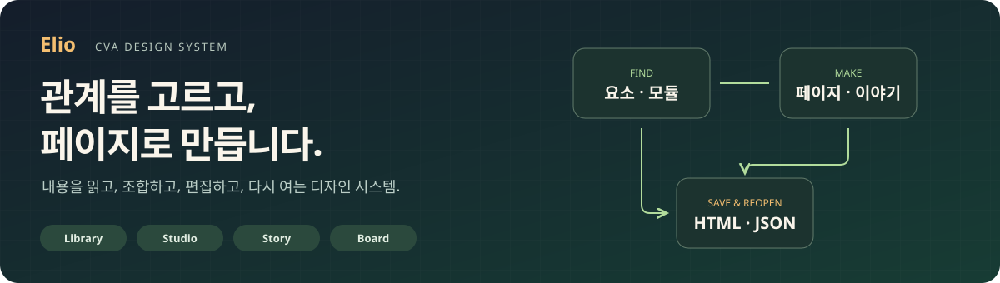
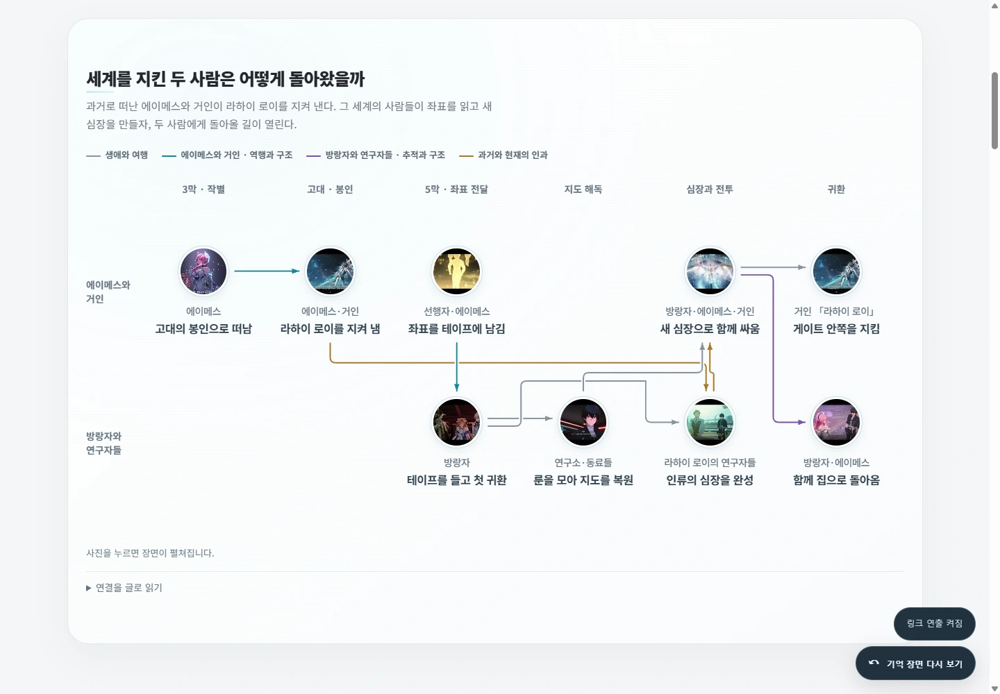

<p align="center"></p>

<h1 align="center">Elio</h1>
<p align="center"><strong>내용의 관계에 맞춰, 읽고 편집할 수 있는 페이지를 만듭니다.</strong></p>
<p align="center"><a href="https://ttaem.com"></a><br><a href="https://ttaem.com">ttaem.com</a> · <a href="https://github.com/ttaem00/cva-elio">cva-elio 원본 저장소</a></p>
<p align="center"><strong>요소·모듈 라이브러리</strong> · <strong>페이지 제작실</strong> · <strong>이야기 저작</strong> · <strong>HTML·JSON 출력</strong></p>
<p align="center"><a href="#quickstart"><strong>빠른 시작</strong></a> · <a href="#features">주요 기능</a> · <a href="#library">라이브러리</a> · <a href="#authoring">Codex·스킬</a> · <a href="#examples">실제 사용 화면</a> · <a href="#policy">이용 정책</a></p>

Elio는 **CVA의 공용 디자인 시스템**입니다. 요소를 고르고 모듈을 조합해 페이지를 편집하며,
이야기는 **Elio Story**, 이야기·도감의 보드는 **Elio Board**로 이어집니다.
스토리게임·드라마·영화·소설·만화처럼 매체가 달라도 내용의 순서·관계·관점과 원문 근거를 구분합니다.

이름·역할·화면 입구·로고 용도·수치 집계의 현재 기준은 [Elio 브랜드와 범위](docs/BRANDING.md)를 따릅니다.
추출 당시 후보 기록과 이 저장소의 소스, 실제 서비스에 반영된 버전은 구분합니다.

| 찾기 | 만들고 편집하기 | 보관하고 다시 열기 |
| :--- | :--- | :--- |
| 분류·검색으로 요소와 모듈 선택 | 페이지 제작실에서 구성·내용·스타일 조정 | 독립 HTML과 편집 JSON 저장 |
| 실제 미리보기와 지원 입력 확인 | 장면·시간·인물·근거를 Story와 Board로 연결 | 같은 입력으로 다시 편집·렌더 |

> [!TIP]
> **처음에는 라이브러리에서 필요한 구성을 고르세요.** 직접 편집하거나, 현재 Codex가 동봉 스킬과 입력 계약을 읽고 기존 소스로 페이지를 만들게 할 수 있습니다.

<details>
<summary><strong>목차 — 시작·기능·저작·검증·정책</strong></summary>

| 시작 | 만들기와 활용 | 확인 |
| --- | --- | --- |
| [빠른 시작](#quickstart) | [페이지 제작실과 Story·Board](#features) | [공용 소스와 검증](#verification) |
| [종류별 라이브러리](#library) | [Codex·저작 스킬](#authoring) | [이용·기여 정책](#policy) |
| [원본 템플릿](docs/ELIO_TEMPLATE_COVERAGE.md) | [실제 사용 화면](#examples) | [브랜드 안내](docs/BRANDING.md) |

</details>

---

<a id="quickstart"></a>
## 빠른 시작

### 1. 소스를 준비하세요

Python **3.12 이상**과 Node.js **22 이상**을 사용합니다.

```sh
git clone https://github.com/ttaem00/cva-elio.git
cd cva-elio
```

### 2. 로컬 미리보기를 여세요

```sh
python -m pip install -r requirements.txt
python -m http.server 8798 --bind 127.0.0.1
```

[localhost:8798](http://127.0.0.1:8798/)를 엽니다. 미리보기에는 로그인이 필요 없습니다.
GitHub에서는 HTML 소스가 표시되므로 실제 조작은 로컬 서버에서 확인하세요.

### 3. 만들려는 내용에서 시작하세요

| 하려는 일 | 로컬 서버에서 열 경로 |
| --- | --- |
| 종류별 요소·모듈 찾기 | [`/cva/library.html?profile=forma&palette=forest`](http://127.0.0.1:8798/cva/library.html?profile=forma&palette=forest) |
| 페이지 구성·내용 편집 | [`/cva/index.html`](http://127.0.0.1:8798/cva/index.html) |
| 이야기 읽기·원본 템플릿 고르기 | [`/examples/templates/index.html`](http://127.0.0.1:8798/examples/templates/index.html) |
| 이야기·도감 보드 열기 | [`/board/index.html`](http://127.0.0.1:8798/board/index.html) |

<a id="features"></a>
## 할 수 있는 일

| 도구·기능 | 사용하는 흐름 |
| --- | --- |
| **Elio 라이브러리** | 버튼·입력·카드·탐색·관계·시간·수치·장면을 쓰임과 구성 단위별로 찾습니다. |
| **페이지 제작실** | 템플릿·섹션·모듈을 골라 내용을 편집하고, 미리보기·JSON·독립 HTML로 보관합니다. |
| **Elio Story** | 장면·인물·시간·관점·분기와 합류를 읽고, 해설·용어·원문 근거에서 관련 장면으로 돌아옵니다. |
| **Elio Board** | 이야기와 도감의 항목을 여러 보기에서 탐색·편집하고 JSON·독립 HTML로 다시 엽니다. |
| **스타일과 색상** | 8가지 스타일과 4가지 색상 조합을 고릅니다. 내용과 관계는 같은 입력 계약을 유지합니다. |
| **Codex 저작 스킬** | Elio·Elio Story 스킬로 기존 컴포넌트와 입력 계약을 읽고 자료에 맞는 페이지를 만듭니다. |

원본 **30개 템플릿·기능 항목과 공용 컴포넌트 소스**를 함께 제공합니다.
선형·사진 흐름·분기·합류·되돌아오는 관계·시간 지도·인물 관점·해설 6종·용어·장면 탐색·영상 연결·공유·Board 등을
[원본 목록과 입력 계약](docs/ELIO_TEMPLATE_COVERAGE.md)에서 확인할 수 있습니다.
방송 영상·후기에는 확인한 본인 자료를 넣어 사용합니다.

<a id="library"></a>
## 종류별 요소·모듈 라이브러리


초록색 라이브러리는 **`/cva/library.html?profile=forma&palette=forest`**에서 엽니다.
분류·검색 → 실제 미리보기 → 제작실에서 편집 → HTML·JSON 저장으로 이어집니다.

`Forma`는 보존한 스타일 선택 이름입니다. 공개판의 관계 엔진은 Elio의 자체 구현이며,
재배포가 제한된 Forma 원본이나 Aceternity 구현은 포함하지 않습니다.
[자체 표현과 지원 입력](docs/OWNED_RUNTIME.md) · [스타일·브랜드](docs/BRANDING.md)

<a id="authoring"></a>
## Codex와 함께 만들기

현재 작업공간에서 [Elio 스킬](skills/elio/SKILL.md)과 [Elio Story 스킬](skills/elio-story/SKILL.md)을 읽고,
필요한 내용·자료·결과물의 형태를 지정합니다. 웹 제작실에서 직접 편집하는 경로도 함께 사용할 수 있습니다.

<details>
<summary><strong>복사해서 요청하기 — 기존 컴포넌트로 페이지 만들기</strong></summary>

> README와 `skills/elio/SKILL.md`를 읽고, 내가 준 내용의 순서·관계·비교에 맞는 기존 모듈과 템플릿을 골라 페이지를 만들어줘. 근거와 관련 항목으로 돌아가는 길을 남기고, 실제 브라우저에서 확인한 뒤 독립 HTML과 다시 편집할 JSON을 저장해줘. 이야기를 다루면 `skills/elio-story/SKILL.md`도 읽어줘. 웹 게시는 하지 마.

특정 작품의 이름·세계관·색·카메라를 다른 자료의 기본값으로 강제하지 않습니다.
자료·이미지·인용에 필요한 권리를 확인하며, 파일 저장과 웹 게시는 구분합니다.

</details>

직접 입력으로 렌더하려면 [이야기 저작 안내](docs/STORY_AUTHORING.md)를 따릅니다.

```sh
python scripts/render_story.py --input examples/story.json --source examples/source.json --connections examples/connections.json --output my-story.html
node scripts/render_cva.cjs --input my-page.cva.json --output my-page.html
python -m tools.elio_board build --input examples/board.catalog.json --output new-board
```

<a id="examples"></a>
<a id="showcase"></a>
## 실제 사용 화면

### 장면·시간·인과를 읽는 지도



Elio Story로 만든 명조 3장 5막의 일반 읽기 화면입니다.
서로 다른 시간과 인물을 한 지도에서 읽고, 사진으로 장면을 펼쳤다가 원래 흐름으로 돌아옵니다.

로컬 경로: `/storytimeline/wutheringwaves/ch3-act5/index.html?story=perspective-causal-reading#perspective-causal-reading-map`

<details>
<summary><strong>해설·원문 근거·장면 복귀 화면 보기</strong></summary>


떡밥과 상징의 해설, 확인한 원문, 관련 장면으로 돌아가는 링크를 같은 읽기 흐름에서 확인합니다.
로컬 경로: `/storytimeline/wutheringwaves/ch3-act5/index.html#guide-deeper-reading`

</details>

일부 작품의 **기억 테이프·달의 기억 같은 3D 진입 연출은 특수 확장 사례**로 동봉합니다. [기존 작품·자산 안내](docs/ORIGINAL_EXAMPLES.md)

실제 화면의 작품·게임·제휴 캐릭터 권리는 각 권리자에게 있습니다.
[스크린샷 출처](docs/screenshots/README.md) · [제3자 고지](THIRD_PARTY_NOTICES.md)

<a id="verification"></a>
## 공용 소스와 예제 확인

```sh
python scripts/build_sources.py --check
python scripts/demo.py --check
node scripts/smoke.cjs
```

원형 CSS·공용 HTML을 수정했다면 `python scripts/build_sources.py`로 브라우저 소스도 다시 생성합니다.
`scripts/demo.py`는 동봉 예제를 재생성하므로 수정한 개인 입력에는 직접 renderer를 사용합니다.
`manifest.json`은 추출 시점의 소스·파일 hash와 후보 상태를 보존하며,
실제 공개 소스의 최신 상태는 이 저장소의 기본 브랜치와 커밋을 따릅니다.

<a id="policy"></a>
## 이용과 기여

**Elio로 만든 결과물의 로고·사이트·저장소 링크 표시는 권장 사항이며 생략할 수 있습니다.**

| 이용 | 조건 |
| --- | --- |
| 비상업적 이용·수정·파일 재배포 | 허용 |
| 수익화된 스트리머·유튜버의 자기 방송 요약·결과물 활용 | 별도 사전 허가 없이 허용. 결과물 로고·링크는 선택 사항 |
| 그 밖의 상업 이용·타인 대상 유·무료 호스팅·생성 대행 | 별도 명시적 서면 허가 필요 |
| 프로그램·코드·포크·패키지·스킬 자체의 재배포 | 로고·사이트·원본 저장소와 이용허락·저작권·제3자 고지 유지 |
| 외부 기여 병합 | 실제 기여자 또는 권리자의 명시적 기여 동의 필요 |

**TTaem CVA Source-Available License 1.1**입니다. OSI 승인 오픈소스 라이선스가 아닙니다.
상업 이용·재배포·기여 정책은 Loki와 같고, Elio 제작 결과물의 출처 표시는 권장으로 완화했습니다.
제3자 구성요소와 작품 자산에는 각 권리자의 조건이 적용됩니다.

[이용허락](LICENSE) · [정책](POLICY.md) · [기여 안내](CONTRIBUTING.md) · [브랜드](docs/BRANDING.md)

<p align="center"><a href="https://ttaem.com">ttaem.com</a> · <a href="https://github.com/ttaem00/cva-elio">cva-elio</a> · <a href="mailto:ttaem00@naver.com">ttaem00@naver.com</a></p>

