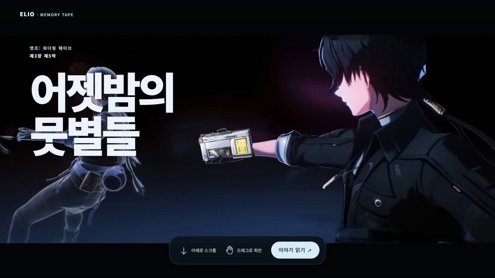
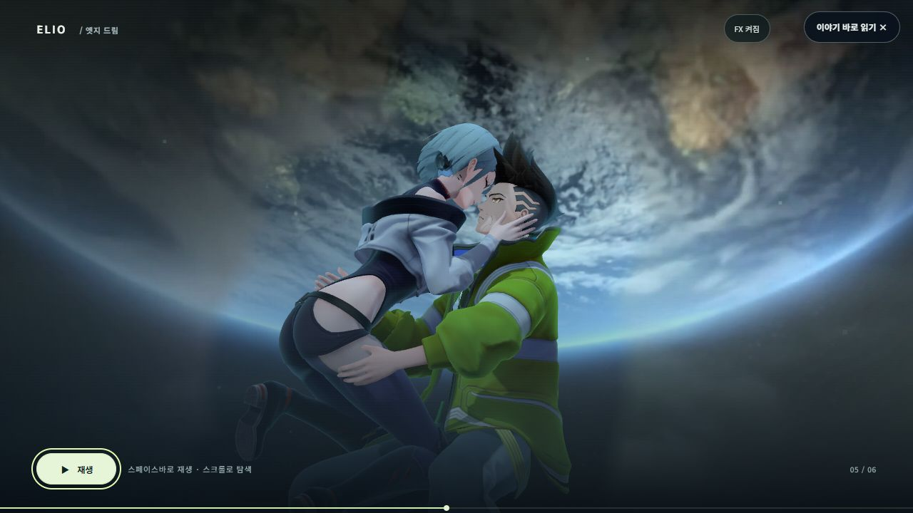

<p align="center"></p>
<h1 align="center">Elio</h1>
<p align="center"><strong>장면을 읽고, 관계를 잇고, 근거로 돌아오는 페이지.</strong><br>CVA 디자인 시스템 · Elio Story · Elio Board</p>
<p align="center"><a href="https://ttaem.com">공식 사이트</a> · <a href="#library">모듈 라이브러리</a> · <a href="#showcase">실제 제작 사례</a> · <a href="#start">시작하기</a> · <a href="POLICY.md">이용 정책</a></p>



<p align="center"><sub>실제 제작 사례 · 명조: 워더링 웨이브 제3장 제5막 「어젯밤의 뭇별들」</sub></p>

Elio는 내용의 관계에 맞춰 **읽기·선택·해설·원문 확인·복귀**를 함께 만드는 디자인 시스템입니다.
스토리게임·드라마·영화·소설·만화의 서로 다른 이야기와 자료에 활용할 수 있습니다.
아래 화면은 실제 Elio 제품과 기존 작품 페이지의 스크린샷입니다.

| 함께 쓰는 도구 | 하는 일 | 입구 |
| --- | --- | --- |
| **Elio** | 요소를 찾고, 모듈을 조합하고, 페이지를 편집합니다. | [요소 라이브러리](cva/library.html) · [페이지 제작실](cva/index.html) |
| **Elio Story** | 장면·인물·시간·관점과 원문 근거를 연결해 이야기를 읽고 씁니다. | [원본 템플릿 자료실](examples/templates/index.html) · [저작 안내](docs/STORY_AUTHORING.md) |
| **Elio Board** | 이야기와 도감의 항목을 보드에서 탐색하고 편집합니다. | [Board](board/index.html) · [Board 소스](tools/elio_board/) |

<a id="library"></a>

## 종류별로 모아 둔, 초록색 라이브러리


버튼·입력·카드·탐색·관계·시간·수치·장면을 **쓰임과 구성 단위별로** 찾습니다.
초록색으로 모아 둔 기존 라이브러리는 이 공개판에도 들어 있습니다.
검색 → 미리보기 → 제작실에서 편집 → HTML·JSON 저장 → 다시 열기로 이어집니다.

로컬 서버를 연 뒤 **`/cva/library.html?profile=forma&palette=forest`**로 들어가면 위 화면을 볼 수 있습니다.
`Forma`는 보존한 스타일 선택 이름입니다. 배포하는 관계 엔진은 Elio가 자체 구현한 소스이며,
재배포가 제한된 Forma 원본이나 Aceternity 구현은 포함하지 않습니다.

**8가지 스타일 · 4가지 색상 조합 · 17계열의 자체 관계 표현**을 제공합니다.
[자체 런타임과 지원 입력](docs/OWNED_RUNTIME.md) · [색·활자·브랜드 안내](docs/BRANDING.md)

<a id="showcase"></a>

## 실제 Elio로 만든 이야기

### 장면과 시간을 함께 읽기


**「어젯밤의 뭇별들」 — 두 사람의 구원과 귀환.**
실제 작품의 장면 사진·행과 열·시간의 역행·현재와 과거의 인과를 하나의 지도에서 읽습니다.
사진을 누르면 해당 장면을 펼치고, 닫으면 원래 흐름으로 돌아옵니다.

로컬 경로: `/storytimeline/wutheringwaves/ch3-act5/index.html?story=perspective-causal-reading#perspective-causal-reading-map`

### 이야기로 들어가는 연출



**「엣지 드림」 — 달의 기억.**
기존 영상·3D 포옹·카메라·마지막 장면과 본문 복귀를 그대로 보존했습니다.
첫 화면의 **기억 테이프**도 기존 명조 3장 5막의 내용과 연출입니다.
두 예제에 쓰이던 최적화 GLB·SPZ·AVIF·MP4를 그대로 동봉합니다.

로컬 경로: `/storytimeline/wutheringwaves/ch3-side-story-edge-dream/index.html`

### 해설에서 원문과 장면으로


**「어젯밤의 뭇별들」 — 먼저 떠난 별들이 남긴 길.**
분류·질문·해설·출처를 구분하고, 확인한 원문과 관련 장면으로 돌아가는 길을 남깁니다.
핵심 흐름·관계·두 관점·질문과 답·떡밥과 상징·인물의 삶, 여섯 종류의 원본 해설을 포함합니다.

로컬 경로: `/storytimeline/wutheringwaves/ch3-act5/index.html#guide-deeper-reading`

**원본 템플릿 30개 항목과 공용 컴포넌트 소스를 모두 포함합니다.**
선형·사진 흐름·분기와 합류·되돌아오는 관계·시간 지도·관점·해설·용어·장면 탐색·영상 연결·공유·Board·진입 연출을
[전체 목록과 입력 계약](docs/ELIO_TEMPLATE_COVERAGE.md)에 연결했습니다.
방송 영상·후기 기능에는 확인한 본인 자료를 넣어 사용합니다.

스크린샷의 작품·게임·제휴 캐릭터 권리는 각 권리자에게 있습니다.
[기존 작품과 최적화 자산](docs/ORIGINAL_EXAMPLES.md) · [스크린샷 출처와 촬영 기준](docs/screenshots/README.md) · [제3자 고지](THIRD_PARTY_NOTICES.md)

<a id="start"></a>

## 시작하기

Python **3.12 이상**, Node.js **22 이상**을 사용합니다.

```sh
git clone https://github.com/ttaem00/cva-elio.git
cd cva-elio
python -m pip install -r requirements.txt
python -m http.server 8798 --bind 127.0.0.1
```

**[localhost:8798](http://127.0.0.1:8798/)**를 열고 라이브러리·제작실·원본 자료실에서 시작합니다.
GitHub 파일 화면은 HTML의 소스를 보여 주므로, 상호작용은 로컬 서버에서 확인하세요.
자료와 편집 파일은 자신의 작업공간에 저장하며, 미리보기에는 로그인이 필요 없습니다.

<details>
<summary><strong>직접 저작하고, 독립 HTML로 보관하기</strong></summary>

Story의 장면·원문·연결 입력은 [저작 안내](docs/STORY_AUTHORING.md)를 따릅니다.
`source_lines`는 실제 원문 줄의 계약이며, 매체의 페이지·패널·타임코드를 임의로 끼워 넣지 않습니다.

```sh
python scripts/render_story.py --input examples/story.json --source examples/source.json --connections examples/connections.json --output my-story.html
node scripts/render_cva.cjs --input my-page.cva.json --output my-page.html
python -m tools.elio_board build --input examples/board.catalog.json --output new-board
```

공개 저작 스킬: [Elio](skills/elio/SKILL.md) · [Elio Story](skills/elio-story/SKILL.md).
특정 작품의 이름·세계관·카메라를 다른 작품의 기본값으로 강제하지 않습니다.
HTML·JSON 저장과 웹 게시는 별개이며 원문·이미지·인용에 필요한 권리를 확인합니다.

</details>

<details>
<summary><strong>공용 소스와 예제의 일치 확인하기</strong></summary>

```sh
python scripts/build_sources.py --check
python scripts/demo.py --check
node scripts/smoke.cjs
```

원형 CSS·공용 HTML을 수정했다면 `python scripts/build_sources.py`로 브라우저 소스도 다시 생성합니다.
`scripts/demo.py`는 동봉 예제를 재생성하므로 수정한 개인 입력에는 직접 renderer를 사용합니다.
`manifest.json`은 추출 시점의 소스·파일 hash와 후보 상태를 보존합니다.
실제 공개 소스의 최신 상태는 이 저장소의 기본 브랜치와 커밋을 따릅니다.

</details>

## 이용과 기여

**Elio로 만든 결과물의 로고·사이트·저장소 링크 표시는 권장 사항이며 생략할 수 있습니다.**

| 이용 | 조건 |
| --- | --- |
| 비상업적 이용·수정·파일 재배포 | 허용 |
| 수익화된 스트리머·유튜버의 자기 방송 요약·결과물 활용 | 별도 사전 허가 없이 허용. 결과물 로고·링크는 선택 사항 |
| 그 밖의 상업 이용·타인 대상 유·무료 호스팅·생성 대행 | 별도 명시적 서면 허가 필요 |
| 프로그램·코드·포크·패키지·스킬 자체의 재배포 | 로고·사이트·원본 저장소와 이용허락·저작권·제3자 고지 유지 |
| 외부 기여 병합 | 실제 기여자 또는 권리자의 명시적 기여 동의 필요 |

**TTaem CVA Source-Available License 1.1** — OSI 승인 오픈소스 라이선스가 아닙니다.
상업 이용·재배포·기여 정책은 Loki와 같고, Elio 제작 결과물의 출처 표시는 권장으로 완화했습니다.
제3자 구성요소와 작품 자산에는 각 권리자의 조건이 적용됩니다.

[이용허락](LICENSE) · [정책](POLICY.md) · [기여 안내](CONTRIBUTING.md) · [브랜드](docs/BRANDING.md)

<p align="center"><a href="https://ttaem.com">ttaem.com</a> · <a href="https://github.com/ttaem00/cva-elio">cva-elio</a> · <a href="mailto:ttaem00@naver.com">ttaem00@naver.com</a></p>
